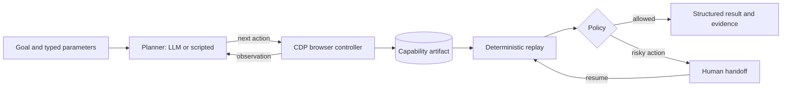

# Computer-Use Automation

**An agent learns a UI task once; after that, the task replays deterministically with new inputs and no LLM in the loop.**

Legacy back-office software rarely has an API, and letting an LLM decide every click is slow, costly and hard to audit. This system splits the problem in two:

1. **Discover.** A planner (an LLM, or an offline scripted planner) drives Chrome through the task once.
2. **Compile.** The successful run is saved as a typed, parameterised capability artifact (`cua.capability.v1`).
3. **Replay.** Later runs execute the artifact directly, with policy checks, redaction, business-outcome detection and human handoff for risky actions.

Everything runs against a bundled legacy-style banking console, so there are no real accounts, credentials or public websites involved.

Author: Dhyan Patel

## Verified behaviour

A full `python run.py demo --llm scripted` run from a fresh clone produces:

| Scenario | Result |
| --- | --- |
| Discovery for member `12345` | Artifact written to `artifacts/member_balance_lookup.json` |
| Replay for member `12345` | `success`: member name returned, balance redacted as `<currency>` in logs |
| Replay for member `99999` | `business_outcome: member_not_found`, reported as an outcome, not a crash |
| Risky "Freeze Card" action | `escalated` to a human operator, then resumed in the same browser session |
| Unit tests | 4 of 4 pass |

## Architecture



| Module | Responsibility |
| --- | --- |
| `cdp.py` | Chrome DevTools Protocol client written from scratch over WebSockets, with no third-party packages |
| `llm.py` | Planner contract with two providers: `scripted` (offline) and `openai` (any OpenAI-compatible endpoint, JSON output) |
| `engine.py` | Discovery loop, artifact compilation and replay with checkpoint verification |
| `policy.py` | Origin and action allowlists; risky actions escalate instead of executing |
| `redaction.py` | Masks member numbers and currency values in logs and results |
| `handoff.py` | Pauses the run, saves a screenshot and DOM snapshot, and resumes in the same session |
| `evidence.py` | JSONL logs, screenshots and DOM snapshots for every run |

## The capability artifact

Discovery doesn't record literal values or brittle selectors. Each step targets an element the way a person would find it, and keeps the CSS path only as a fallback hint. This step is taken from the generated artifact:

```json
{
  "id": "fill_member_id",
  "action": "fill",
  "target": {
    "strategy": "row_label",
    "label": "Member / Account Number",
    "role": "input",
    "rationale": "Legacy table row labels are more robust here than generated CSS paths."
  },
  "value_template": "{{member_id}}"
}
```

The full artifact also declares typed parameters and outputs, a success condition, known business outcomes, an error contract and a policy reference, so a replay can be validated before it runs.

## Safety by design

- **Allowlists.** Only `localhost` origins and eight action types (`navigate`, `click`, `fill`, `extract`, `checkpoint`, `wait`, `screenshot`, `handoff`) are permitted. See [`config/policy.json`](config/policy.json).
- **No secrets in artifacts.** The member ID is stored as `{{member_id}}`, never as a literal.
- **Redaction.** Member-number-like values and currency amounts are masked before anything is logged.
- **Human handoff.** Irreversible actions such as freezing a card pause for an operator, who can inspect the live session and approve or decline. The demo includes a scripted operator response.

## Run it

**Requirements:** Python 3.11+ and Chrome or Edge. The offline demo needs no `pip install`.

```powershell
python run.py demo --llm scripted
```

If Chrome isn't found automatically, set `CHROME_PATH` to the browser executable.

### With an LLM planner

The `openai` planner works with any OpenAI-compatible chat completions endpoint:

```powershell
$env:OPENAI_API_KEY = "your_key_here"
$env:OPENAI_MODEL = "gpt-4.1-mini"             # optional
$env:OPENAI_BASE_URL = "https://api.openai.com/v1/chat/completions"   # optional
python run.py demo --llm openai
```

The committed evidence in [`evidence/`](evidence/) was produced with the scripted planner, which follows the same action contract, so the artifact, replay and safety paths are identical.

### Step by step

```powershell
python run.py serve-target --port 8088          # terminal 1
python run.py discover --llm scripted --target http://127.0.0.1:8088/ --member-id 12345 --goal "Look up member 12345 and read their current savings balance."
python run.py replay --target http://127.0.0.1:8088/ --member-id 12345
python run.py replay --target http://127.0.0.1:8088/ --member-id 99999
python run.py demo-handoff --target http://127.0.0.1:8088/ --member-id 12345
```

Replay commands never call an LLM. They load the artifact, fill in parameters, execute the steps, verify the checkpoint and return a structured result.

## Tests

```powershell
python -m unittest discover -s tests
```

The tests cover policy allowlisting, redaction, parameter materialisation and the artifact schema.

## Design write-up

[REPORT.md](REPORT.md) covers the design decisions, failure modes and trade-offs in detail.

## Next steps

- Regenerate the discovery evidence with a live LLM planner.
- Add self-healing replay: when a locator fails, fall back to a scoped re-discovery instead of failing the run.
- Support multi-capability workflows that chain artifacts.

## Notice on GenAI usage

I used GenAI tools while building this project, mainly for boilerplate, code structure, documentation structure and improvement suggestions. I did not use GenAI as a replacement for understanding the assignment or the design decisions. I reviewed the code, ran the tests, generated the evidence and made the final implementation choices myself.
